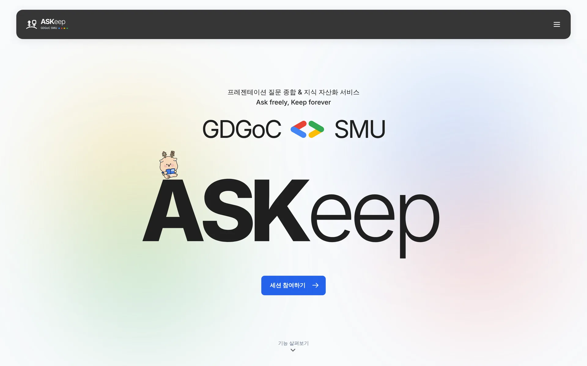
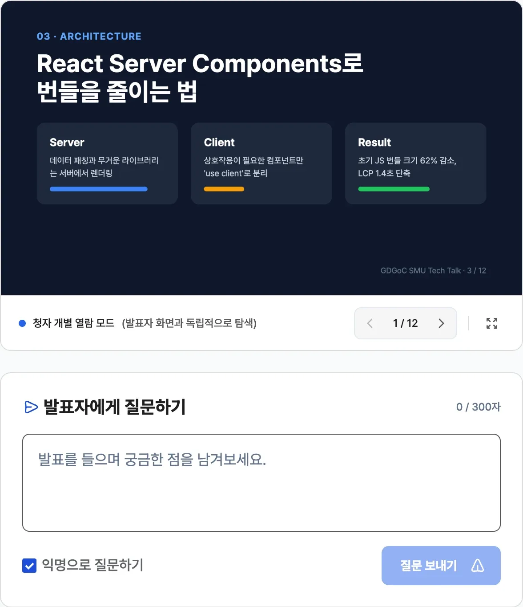
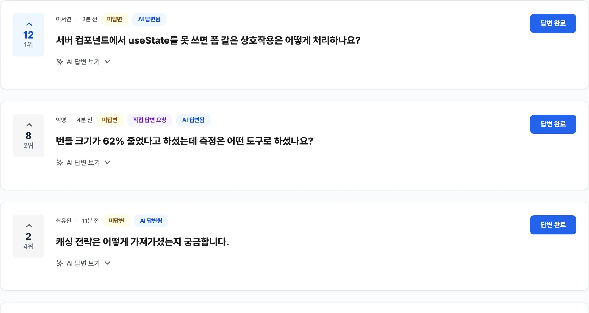
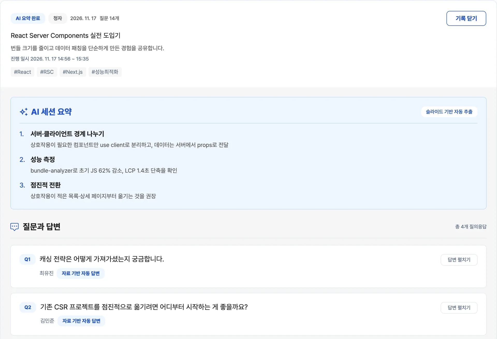

<div align="center">


# ASKeep · 애스킵

**Ask freely, Keep forever.**<br>
발표 질문을 모으고, AI가 발표 자료로 먼저 답하고, 끝난 세션은 지식으로 남기는 발표 Q&A 서비스

🏆 GDGoC on Sangmyung 팀 프로젝트 **3위**


[**서비스 바로가기 →**](https://askeep.vercel.app)



</div>

## 소개

발표가 끝나면 질문은 손을 든 몇 명의 것으로만 끝나고, 좋은 질문과 답은 그 자리에서 사라집니다. ASKeep은 이 문제를 풀기 위한 발표 질문 종합·지식 자산화 서비스입니다. 이 저장소는 프론트엔드이며, 초기 세팅부터 배포까지 1인으로 담당했습니다.

| 질문하기 | AI 답변 |
|:---:|:---:|
|  |  |
| **발표자 화면** | **아카이브** |
|  |  |

## 주요 기능

- **바로 입장** — 발표 화면의 QR·입장 코드·초대 링크로 청중이 들어와 각자 화면에서 슬라이드를 넘겨 보며 실명 또는 익명으로 질문
- **AI 우선 답변** — 발표 자료(PDF)에 있는 내용은 AI가 먼저 답하고 근거 슬라이드 페이지를 함께 표시 (RAG)
- **질문 정렬** — 발표자 화면에는 '나도 궁금해요'를 많이 받은 질문부터 노출
- **아카이브** — 세션이 끝나면 AI 요약과 질문·답변이 남아 태그·키워드로 다시 검색
- **실시간** — STOMP 웹소켓으로 세션 시작·종료 이벤트를 받아 캐시를 갱신하고, 재연결 시 질문을 다시 받아 끊김에 대비

> 백엔드는 Spring Boot · PostgreSQL, AI 서버는 FastAPI · multilingual-e5 임베딩 · Gemini로 구성되어 있습니다.

## 커밋 메시지 컨벤션

커밋 메시지는 `타입: 작업 내용` 형식으로 작성합니다. (예: `feat: 로그인 페이지 추가`)

| 타입       | 설명                                                                      |
| ---------- | ------------------------------------------------------------------------- |
| `init`     | 초기 세팅                                                                 |
| `build`    | 빌드 시스템 또는 외부 종속성에 영향을 미치는 변경 사항 (예: webpack, npm) |
| `chore`    | 패키지 매니저 수정, 그 외 기타 수정 (예: .gitignore)                      |
| `ci`       | CI 설정 파일 및 스크립트 수정                                             |
| `docs`     | 문서 수정                                                                 |
| `feat`     | 새로운 기능 추가                                                          |
| `fix`      | 버그 수정                                                                 |
| `perf`     | 성능을 개선하는 코드 변경 사항                                            |
| `refactor` | 코드 리팩토링                                                             |
| `revert`   | 이전 커밋 되돌리기                                                        |
| `style`    | 스타일 코드 변경                                                          |
| `asset`    | svg, 이미지 등 디자인 파일 추가                                           |
| `test`     | 테스트 코드, 리팩토링 테스트 코드 추가                                    |
| `type`     | 타입 수정                                                                 |
| `rename`   | 파일 또는 폴더 명을 수정하거나 옮기는 작업만인 경우                       |
| `remove`   | 파일 삭제하는 경우                                                        |
| `HOTFIX`   | 급하게 치명적인 버그를 고쳐야 하는 경우                                   |

## 기술 스택

| 구분          | 사용 기술       |
| ------------- | --------------- |
| 프레임워크    | React 19        |
| 언어          | TypeScript      |
| 빌드 도구     | Vite            |
| 패키지 매니저 | pnpm            |
| 스타일링      | Tailwind CSS v4 |
| 린터          | ESLint          |
| 포매터        | Prettier        |

## 1. 사전 준비

아래 도구가 설치되어 있어야 합니다. 터미널에서 버전이 출력되는지 확인하세요.

```bash
git --version
node --version   # v20.19 이상 권장 (v22 LTS 추천)
pnpm --version
```

### Node.js 설치

[nodejs.org](https://nodejs.org)에서 LTS 버전을 설치하세요. macOS라면 Homebrew로도 설치할 수 있습니다.

```bash
brew install node
```

### pnpm 설치

Node.js가 설치되어 있다면 아래 중 하나로 설치할 수 있습니다.

```bash
# 방법 1: corepack (Node.js에 내장, 추천)
corepack enable pnpm

# 방법 2: npm으로 설치
npm install -g pnpm

# 방법 3: Homebrew (macOS)
brew install pnpm
```

> 이 프로젝트에서는 `npm install`, `yarn`을 쓰지 않습니다. `package-lock.json`이 생기면 충돌의 원인이 되니 반드시 `pnpm`만 사용하세요.

## 2. 프로젝트 받기

```bash
git clone https://github.com/jiwonsudo/askeep-frontend.git
cd askeep-frontend
```

## 3. 의존성 설치

```bash
pnpm install
```

`node_modules` 폴더가 생기면 성공입니다. 처음 받았거나 `pull`로 `package.json`이 바뀐 뒤에는 항상 다시 실행해 주세요.

## 4. 개발 서버 실행

```bash
pnpm dev
```

터미널에 `http://localhost:5173` 주소가 나오면 브라우저에서 열어 확인합니다. 코드를 저장하면 화면이 자동으로 갱신됩니다(HMR). 종료는 터미널에서 `Ctrl + C`.

## 5. 주요 명령어

| 명령어                 | 설명                                      |
| ---------------------- | ----------------------------------------- |
| `pnpm dev`             | 개발 서버 실행                            |
| `pnpm build`           | 타입 검사 후 프로덕션 빌드 (`dist/` 생성) |
| `pnpm preview`         | 빌드 결과물을 로컬에서 미리보기           |
| `pnpm lint`            | ESLint로 코드 검사                        |
| `pnpm lint:fix`        | ESLint 자동 수정 가능한 문제 고치기       |
| `pnpm format`          | Prettier로 전체 코드 포맷팅               |
| `pnpm format:check`    | 포맷이 맞는지 검사만 (수정 X)             |
| `pnpm add <패키지>`    | 라이브러리 추가                           |
| `pnpm add -D <패키지>` | 개발용 라이브러리 추가                    |
| `pnpm remove <패키지>` | 라이브러리 삭제                           |

## 6. 폴더 구조

```
askeep-frontend/
├── public/            # 그대로 서비스되는 정적 파일 (favicon 등)
├── src/
│   ├── assets/        # 이미지, 아이콘 등 (필요할 때 추가)
│   ├── App.tsx        # 최상위 컴포넌트
│   ├── index.css      # Tailwind 불러오기 (전역 스타일)
│   └── main.tsx       # 앱 진입점
├── index.html         # HTML 엔트리
├── vite.config.ts     # Vite 설정
├── tsconfig*.json     # TypeScript 설정
├── eslint.config.js   # ESLint 규칙
├── .prettierrc        # Prettier 규칙
├── .vscode/           # 팀 공통 VS Code 설정
└── package.json       # 의존성과 스크립트
```

## 7. 스타일링 (Tailwind CSS)

CSS 파일을 따로 만들지 않고, 태그의 `className`에 유틸리티 클래스를 붙여서 스타일을 지정합니다. 이미 설치와 설정이 끝나 있어서 바로 쓰면 됩니다.

```tsx
<button className="rounded-lg bg-blue-600 px-4 py-2 font-semibold text-white hover:bg-blue-700">
  저장
</button>
```

- 클래스 이름이 기억나지 않을 때는 [Tailwind 공식 문서](https://tailwindcss.com/docs)에서 검색하세요. (예: "padding", "flex")
- VS Code 확장 **Tailwind CSS IntelliSense**를 설치하면 클래스 자동완성이 됩니다.
- 색상, 폰트 같은 공통 값을 바꾸고 싶으면 `src/index.css`에 `@theme` 블록으로 추가합니다.

## 8. 코드 스타일 (ESLint + Prettier)

팀원 모두 같은 코드 스타일을 유지하기 위해 ESLint(문법/버그 검사)와 Prettier(줄바꿈, 따옴표 등 모양 정리)를 사용합니다.

- 스타일 규칙: 세미콜론 없음, 작은따옴표, 2칸 들여쓰기 (`.prettierrc`)
- Tailwind 클래스는 Prettier가 권장 순서로 자동 정렬합니다.
- **VS Code를 쓴다면** 프로젝트를 열 때 추천 확장 설치 알림이 뜹니다. 모두 설치하면 파일을 저장할 때마다 자동으로 포맷팅되고 ESLint 문제도 고쳐집니다. (`.vscode/settings.json`에 설정되어 있습니다.)
- 커밋/PR 전에 아래 명령어로 한 번 확인하세요.

```bash
pnpm format
pnpm lint
```

## 9. Git 협업 흐름

`main`에 직접 푸시하지 말고, 브랜치를 따서 작업한 뒤 Pull Request를 올립니다.

```bash
# 1. 최신 main 받아오기
git checkout main
git pull origin main

# 2. 작업 브랜치 만들기
git checkout -b feat/기능-이름

# 3. 작업 후 커밋
git add .
git commit -m "feat: 로그인 페이지 추가"

# 4. 원격에 푸시 후 GitHub에서 Pull Request 생성
git push origin feat/기능-이름
```

커밋 메시지는 맨 위의 [커밋 메시지 컨벤션](#커밋-메시지-컨벤션)을 따릅니다.

## 10. 자주 겪는 문제

**`pnpm: command not found`**
pnpm이 설치되지 않은 상태입니다. 1번의 pnpm 설치를 진행한 뒤 터미널을 껐다 켜세요.

**`Port 5173 is already in use`**
이미 다른 개발 서버가 켜져 있습니다. 기존 터미널에서 `Ctrl + C`로 종료하거나 `pnpm dev --port 3000`처럼 다른 포트를 지정하세요.

**설치 후 이상한 에러가 날 때**
의존성을 깨끗하게 다시 설치해 보세요.

```bash
rm -rf node_modules
pnpm install
```

**Node 버전 관련 에러**
`node --version`이 너무 낮은 경우입니다. 최신 LTS로 올려 주세요.
